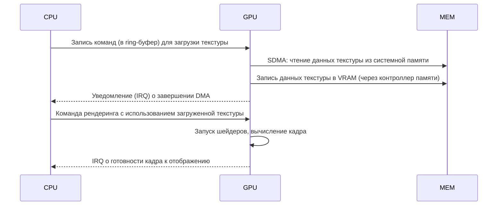
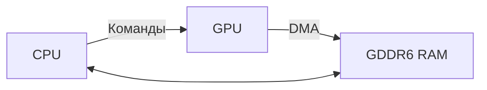

# Краткое содержание  
Консоль PS5 построена на кастомном SoC от AMD, сочетающем 8‑ядерный CPU (Zen 2) и GPU на базе архитектуры RDNA 2. Оба блока разделяют один пул памяти: 16 ГБ GDDR6 (256‑бит шина, до 448 ГБ/с). CPU работает на частоте до 3,5 ГГц (Zen 2 7 нм) и, по данным патентов, использует унифицированный L3‑кэш (как в Zen 3). Графическое ядро имеет 36 вычислительных блоков (CU) при частоте до 2,23 ГГц, обеспечивая ~10,28 TFLOPS с поддержкой аппаратного RT. Память GDDR6 связана с GPU через 8 каналов по 32 бита (скорость ~14 Гб/с на линию) и контролируется встроенным контроллером памяти. Память CPU и GPU общая (UNITED MEMORY), поэтому производится согласованность кэшей и синхронизация доступа через шину Infinity Fabric (по аналогии с архитектурой AMD) и механизмы DMA. В отчёте разобраны пути доступа к памяти, кэширование, SIMD‑конвейеры RDNA2, DMA-движок, контроллеры памяти, вопросы согласованности (coherency) и синхронизации CPU/GPU. Представлены известные аппаратные регистры (или их вероятные аналоги из AMD) и примеры типовых последовательностей команд для загрузки текстур, передачи данных и синхронизации.  

## Аппаратный обзор PS5  
**SoC и CPU.** PS5 использует AMD Zen 2 (8 ядер/16 потоков) с общей L3-кэш-памятью (по патентам Sony, «общий L3-кеш» как в Zen 3). Максимальная частота CPU – ~3.5 ГГц. CPU имеет стандартный набор x86 регистров (RAX, RBX,…), управляемые кэшами L1/L2 и общий L3. Для управления энергопотреблением и частотами применяются MSR-регистры (APERF/MPERF), а также контроллеры памяти и I/O.  

**GPU.** Графический блок – AMD RDNA 2 с 36 CU (по 64 ALU в каждом). Блоки сгруппированы по два в WGP (Workgroup Processors) для совместного исполнения. Поддерживается исполнение wavefront’ов длиной 32 или 64, параллельное выполнение скалярных и векторных операций, и аппаратное трассирование лучей. На уровне кэшей в каждом CU есть L0/L1, далее общий уровень L2 на шейдерный движок. Предполагается также наличие «Infinity Cache» (~128 МБ в классических RDNA2) или её вариант в PS5.  

**Память.** Оперативная память – 16 ГБ GDDR6, соединённая по 256‑бит шине, совокупная пропускная способность до 448 ГБ/с. Память одной линией 256‑бит распределена, вероятно, на 8 чипов по 32 бита. Частота передачи – ~14 Гбит/с на линию, напряжение GDDR6 ~1.35 В. Дополнительно на плате есть 512 МБ DDR4 (кэш контроллера SSD) и у PS5 Pro — 2 ГБ DDR5 для системных задач. Память CPU и GPU — единая (UNIFIED MEMORY), т.е. обе подсистемы видят одни и те же данные.  

**Кэширование и согласованность.** CPU кэширует данные в L1/L2/L3, GPU – в собственных кэши (L0/L1/L2). При обмене данными применяются механизмы сброса/инвалидации кешей. Infinity Fabric обеспечивает коммуникацию и (вероятно) когерентность между блоками. Л3‑кэш CPU общий для всех ядер, что снижает задержки межъядерного взаимодействия. Предполагается, что GPU шейдеры могут напрямую обращаться к основной памяти через контроллеры памяти без явного перекопирования данных (как в UMA).  

**Интерфейсы.** Для внешних устройств SoC имеет шину PCIe 4.0 (x4) для NVMe SSD (825 GB встроенный SSD). Данные со скоростью до 5.5–9 ГБ/с (сырой) направляются по 12 каналам PCIe к контроллеру SSD. Интерфейс Infinity Fabric связывает CPU, GPU и другие узлы SoC. Также присутствуют шины USB 3.2, USB-C, HDMI 2.1, Gigabit Ethernet и др., но они не участвуют в CPU–GPU–RAM взаимодействиях.  

## Подсистема памяти  
- **Контроллеры памяти.** GDDR6-контроллеры, вероятно интегрированы в GPU-чип. Каждый контроллер обрабатывает 32‑бит канал GDDR6. В сумме 8 каналов по 32 бита обеспечивают 256‑бит шину. Контроллеры работают в связке с графическим ядром и организуют доступ к DRAM. CPU обмен данными с GDDR6 происходит через общую fabric (через контроллеры GPU). Контроллеры также инкапсулируют L2-кэш GPU и управляют очередями запросов (многоуровневая иерархия памяти).  

- **Характеристики GDDR6.** Пропускная способность одна линия ~14 Гбит/с. Совокупно 8 каналов дают ~448 ГБ/с. Латентность GDDR6 выше, чем у SRAM, но ниже, чем у обычной DDR4: в районе десятков наносекунд (точные цифры не опубликованы). За счёт ширины и памяти высокой тактовой частоты достигается высокий throughput. Важно выравнивать доступы по границам кеш-линий (128 байт для RDNA2) для эффективной работы.  

- **Кэширование.** GPU RDNA2 использует многоуровневый кэш: L1 (в каждом SIMD-блоке), L2 (общий шейдерному движку) и, возможно, великий «Infinity Cache» (большой слой on-chip). CPU Zen2 имеет L1 (64+64 КБ на ядро), L2 (512 КБ на ядро) и глобальный L3 (~16 МБ на весь CCX, но в PS5 объединён). Кэши L3 могут кэшировать данные как для CPU, так и (при поддержке) GPU через когерентный протокол Infinity Fabric. При DMA-загрузках GPU данные минуют L1/L2 CPU и вставляются в кэш L3 CPU при чтении, при необходимости выполняются сбросы/инвалидации.  

- **Когерентность и синхронизация.** В PS5 CPU и GPU разделяют данные, поэтому критична согласованность кэшей. В программном API Sony («GNM/AGC») предоставляются барьеры и синхронизационные команды (fence, event, spinlock) для CPU–GPU. Например, CPU может ждать сигнала от GPU (Interrupt) об окончании копирования данных. Платформа предполагает полную когерентность для Unified Virtual Memory (по аналогии с архитектурой AMD EPYC+Radeon), но фактический уровень когерентности PS5 не раскрыт. Вероятно, предусмотрены механизмы сброса кэшей (например, регистры очистки HDP_ARB_COHERENCY_FLUSH) для гарантии целостности данных между CPU и GPU.  

## Микроархитектура GPU и шейдеры  
- **Compute Units (CU).** Каждая CU RDNA2 содержит 64 SIMD ALU (способны исполнять 32‑ или 64‑битные волны) и разделяет данные через скоростные блоки (L0/L1). Две CU объединены в **WGP** с общими загрузчиком и плейсментом. Всего PS5 GPU содержит 36 CU (18 WGP).  

- **Исполнительные конвейеры.** RDNA2 поддерживает две форматы wave: Wave32 (32 lanes) и Wave64 (64 lanes). Микроархитектура предусматривает одновременный выпуск инструкций (issue) и возможность однократной выдачи одной инструкции на такт (single-issue). Для повышения производительности имеются 2 скалярных ALU на WGP (для операций с целыми числами), а векторные операции обрабатываются SIMD-блоками.  

- **Кэш-память.** Каждый SIMD-блок имеет собственный L0-кэш (часто 16–32 КБ), общий L1-каша (обычно 64 КБ) на CU и общий L2-кэш на уровне всего шейдерного движка (например, 2–4 МБ на shader engine). Кэш-линия RDNA2 – 128 байт. Добавление L1 позволяет более эффективно использовать вычислители (по данным AMD, повышение L1 ускоряет заполнение ALU).  

- **Графические стадии.** Шейдеры упорядочены по традиционному конвейеру: вершинный/тесселяционный, геометрический, пиксельный шейдеры; HDR операции. У RDNA2 также есть поддержка *Pixel Shaders* (PS) и *Compute Shaders*. Адаптивно поддерживается трассировка лучей: в CU встроены блоки Ray Accelerator для обхода BVH и проверки пересечений.  

- **Системные блоки.** Помимо вычислительных блоков, есть: 
  - **Command Processor (CP)** – планирует и распределяет команды из ring-буферов;  
  - **Graphics Pipeline Front-End** – включает фиксированные блоки растеризации, зигзаги (растрирование), ROP (Render Output) – примерно 64 ROP в PS5;  
  - **SDMA (System DMA)** – два движка DMA для копирования данных между памятью и внутренними буферами (буферы кадра, текстур);  
  - **HDP (Host Data Path)** – управляет доступом CPU/GPU к памяти, кэшам и шинам;  
  - **VCN/JPEG/Audio DSP** – медиа/звуковые сопроцессоры (VCN для видео, но не в область GPU).  

## CPU и взаимодействие с памятью  
CPU Zen 2 в PS5 почти не отличается от настольной версии, за исключением адаптации к GDDR6. Внутренний контроллер DDR заменён на интерфейс к GDDR6 (через Infinity Fabric). Характерные для Zen регистры управления памятью (MTRR, PAT) применимы по аналогии. Zen2 имеет 32 ГБ пространства виртуальной памяти, PTE (4‑level paging).  

- **Доступ к общей памяти.** CPU читает/записывает GDDR6 через L1→L2→L3→к контроллеру памяти. Поскольку память общая, GPU видит изменения CPU после сброса кэша. Для контроля доступа CPU/GPU используют сигналы барьеров: CPU может сделать `DRM_FENCE`/`Membarrier`, GPU – сбросы L1/L2. Совместная работа CPU и GPU рекомендуется через согласованные буферы (например, ring-буфер команд и texture streaming buffers).  

- **Кэш L3.** По данным Sony, PS5 использует «общий L3 кэш, как в Zen 3». Предположительно, все 8 ядер Zen2 разделяют единую L3 (в отличие от традиционного Zen2 CCX с двумя отдельными блоками). Это снижает задержку обмена данными меж ядрами и упрощает когерентность с GPU. L3-кэш может поддерживать запросы и GPU (через IF), хотя детали неизвестны.  

- **Системная шина и Infinity Fabric.** CPU соединён с GPU и I/O через шину Infinity Fabric. На уровне ядра это высокоскоростной межсоединитель, обеспечивающий до нескольких сотен гигабайт в секунду (на практике объединённый пропуск Infinity Fabric в PS5 соответствует ~128 ГБ/с на каждый канал). Он также реализует протокол согласованности кэшей (Coherent Fabric Link). При загрузке текстур CPU записывает данные в системную память, затем GPU через IF переключается в режим чтения этих данных (часто через DMA).  

- **Контроллер памяти.** Изначально Zen2 умеет работать с DDR4, однако в кастомном SoC контроллер GDDR6 может быть унифицированным или частично реализованным в GPU. Поэтому при выполнении операций памяти CPU фактически выдаёт команды на Infinity Fabric, передавая их GPU-контроллеру памяти. То есть физически контроллер GDDR6, скорее всего, в «GPU-части» SoC, а CPU обращается к памяти через протокол Infinity Fabric.  

## Межкомпонентные интерфейсы (I/O, шины)  
- **Infinity Fabric (IF).** Основной внутренняя шина. Связывает CPU, GPU, PCIe, память и вспомогательные блоки. Поддерживает когерентную связь между CPU и GPU. Предполагается, что IF работает на частоте, кратной частоте памяти, для обеспечения синхронности. Он же обслуживает внутренний контроллер PCIe и контроллер памяти.  

- **PCI Express 4.0 x4.** Используется для подключения встроенного SSD (NVMe). Общая пропускная способность до ≈64 ГБ/с. SSD связана через 12-канальный контроллер, данные шифруются/декомпрессируются специализированным ядром. Для CPU/GPU доступ к SSD идёт через отдельные шины контроллера и IF.  

- **USB/HDMI/Ethernet.** Их роль в CPU–GPU–RAM взаимодействии пренебрежимо мала (выход на периферию). Используются для загрузки данных из внешних устройств, но в контексте памяти они миновали SoC.  

## Регистры SoC PS5 (примерные)  
Документация Sony не раскрывает адресов регистров SoC. Ниже приведены примерные названия ключевых регистров (по аналогии с GPU AMD RDNA/GGX) и их функции. Адреса и поля неизвестны (размечены как «не документировано»), приведено назначение и эффекты.

| Название регистра             | Адрес/Смещение           | Биты/Поля (пример)         | Описание и назначение                                                                                                   |
|-------------------------------|--------------------------|---------------------------|-------------------------------------------------------------------------------------------------------------------------|
| **CPU: APERF**                | MSR 0xE8 (пример)        | [31:0] (часть CPUID)      | Счётчик «actual performance». Подсчитывает такты процессора в режиме исполнения. Используется для режима Turbo (P-States). |
| **CPU: MPERF**                | MSR 0xE7 (пример)        | [31:0] (часть CPUID)      | Счётчик «max performance». Подсчитывает такты при максимальной частоте. В паре с APERF определяет усредненную частоту CPU. |
| **GPU_CP_RB0_BASE**           | *не документировано*     | [31:0] Базовый адрес      | Базовый адрес (виртуальный/физический) кольцевого буфера команд (Ring Buffer 0) для командного процессора GPU.            |
| **GPU_CP_RB0_WPTR**           | *не документировано*     | [31:0] Запись указателя   | Текущий write-пойнтер кольцевого буфера команд. GPU записывает команды здесь, инкрементируя указатель.                    |
| **GPU_CP_RB0_RPTR**           | *не документировано*     | [31:0] Чтение указателя   | Указатель чтения Ring Buffer для командного процессора (CP). После исполнения команд указатель продвигается.                 |
| **GPU_MC_VM_AGP_BASE**        | *не документировано*     | [31:0] Базовый адрес AGP  | Base address of GPU memory page tables (GART). Используется виртуальной памятью GPU для трансляции адресов.               |
| **GPU_MC_VM_AGP_TOP**         | *не документировано*     | [31:0] Верхний адрес AGP  | Верхний (max) адрес области виртуального адресного пространства GPU.                                                   |
| **GPU_MC_L2_CNTL**            | *не документировано*     | [1:0] ENABLE, FLUSH       | Управление L2-кэшем GPU: включает кэш, сбрасывает данные и синхронизирует с памятью при изменении конфигурации.          |
| **GPU_COHER_CNTL**            | *не документировано*     | [0] GLOBAL_COHERENCY      | Управление согласованностью кэша между CP (CPU) и GPU. При записи 1 инициирует сбросы/инвалидацию L1/L2.                |
| **GPU_GRBM_STATUS**           | *не документировано*     | [0] BUSY, [1] IDLE        | Статус Graphics Register Bus Manager. Индикация активности шин GPU (0 – BUSY, 1 – IDLE).                                  |
| **GPU_SDMA_CH0_CNTL**         | *не документировано*     | [0] DMA_ENABLE           | Управление каналом SDMA0 (DMA-движка): разрешение/запрещение передачи, состояние ошибки и т.п.                           |
| **HDP_MEM_COHERENCY_FLUSH**   | *не документировано*     | [0] FLUSH_ALL            | Сброс согласованности хоста: при установке 1 производит сброс кэша L1/L2 и подтверждение, что GPU и CPU память синхр.    |

*Пояснения:* приведены гипотетические регистры по аналогии с архитектурой AMD RDNA/GPU: CP – Command Processor, MC – Memory Controller, SDMA – DMA-движок, HDP – Host Data Path. Точные адреса и битовые поля для PS5 неизвестны. Например, регистры CP_RB0_* в AMD GPU контролируют кольцевой буфер команд и используются при записи команд CPU в GPU. Регистры MC_VM_* задают границы виртуальной адресации GPU (аналогичны GART у AMD). Регистры сброса согласованности (coherency) обеспечивают корректное взаимодействие CPU/GPU при разделённой памяти.

## Примеры командных последовательностей  
Ниже приведены упрощённые примеры, иллюстрирующие взаимодействие CPU–GPU–RAM при типовых сценариях (псевдокод).  

- **Загрузка текстур (через DMA):** CPU выделяет буфер для текстуры в общей памяти, заполняет его данными. Затем CPU формирует команду отправки DMA: записывает в соответствующие регистры SDMA адрес источника (системная память) и назначения (GPU VRAM), указывает размер. Команда помещается в ring-буфер команд GPU. GPU, выполняя очередь, читает регистры SDMA, самостоятельно копирует данные по шине Memory Controller в VRAM. После завершения GPU устанавливает флаг в регистре статуса или вызывает прерывание. CPU, опросив флаг или получив IRQ, подтверждает завершение.  
- **Синхронизация CPU–GPU:** CPU посылает коменд-буфер GPU, затем ожидает завершения (fence). Пример: CPU записывает в ring-буфер команд GPU команду «Signal Event X», а затем делает `membarrier()`/ожидание IRQ. GPU после выполнения всех предыдущих команд пишет в память метку (fence) или инициирует прерывание на адрес CPU. CPU проверяет флаг и продолжает. В PS5 API обычно используется «fence» (команда GPU) и «wait on fence» (CPU).  
- **Пример shader dispatch (Compute):** CPU/OS заполняет буфер констант, указывает адрес GPU kernel (дескриптор). Через регистры команд CP запускается вычисление. GPU берет задачу (wavefront), исполняет в SIMD ALU, результаты пишет в буфер VRAM. Затем GPU дожидается барьера (all threads) или завершения, и ставит флаг завершения. CPU затем может прочесть результаты из VRAM (через прерывание и синхронизацию).  

Пример условного расписания (`mermaid` sequence):

Также можно представить поток данных (`mermaid` flow):

## Выводы и рекомендации  
PS5 предлагает мощный унифицированный доступ к памяти с высокой пропускной способностью, но требует тщательного управления данными на низком уровне. Для оптимизации рекомендуются:
- **Выравнивание и плотность данных:** Пакеты данных выравнивать по 128 байтам (размер кеш-линии RDNA2), чтобы не было лишних частичных загрузок.  
- **Учет топологии памяти:** Минимизировать частые переключения между CPU/GPU. Лучше загружать большие блоки данных (текстур, мешей) единоразово, используя DMA-подкачку, а не выполнять много мелких копирований.  
- **Префетчинг и буферизация:** Использовать асинхронные копии (SDMA) и предзагрузку текстур до их использования GPU; CPU может запускать подготовку данных параллельно с вычислением на GPU.  
- **Избегать конфликтов кеша:** При совместном доступе CPU и GPU после записи одним из них в общую память (например, после DMA) вызывать соответствующие барьеры/сбросы кеша, чтобы другой прочитал актуальные данные.  
- **Использование кешей GPU:** Перемещать вычисления ближе к данным – выполнять как можно больше операций на GPU, чтобы избежать медленных обращений CPU к GDDR. Например, выполнять оптимизационные прогоны на Compute Shader’ах, чтобы уменьшить загрузку CPU.  
- **Мониторинг производительности:** Воспользоваться профайлерами (Nintendo, GPUOpen) для выявления узких мест в памяти и расписания шейдеров.  

В целом, эффективная работа на PS5 требует знания специфики RDNA2 и Zen2: нужно балансировать нагрузку между CPU и GPU, аккуратно синхронизировать доступ к общим данным, выравнивать и группировать данные для кэшей, а также минимизировать кросс-обращения по шине памяти.  

## Источники  
- Официальный обзор характеристик PS5 (Wikipedia).  
- Статья-исследование по PS5 на русском (GoHa.ru) – о найденном патенте, едином L3 и Infinity Cache.  
- Техническая информация по AMD RDNA2 (RDNA2 Architecture Manual).  
- Презентации и обзоры (Igor’sLab и др.) по архитектуре PS5/PS5 Pro.  
- Общие сведения об архитектурах Zen2 и RDNA2, характеристики памяти GDDR6 (официальные пресс-релизы AMD, презентации).  

*Замечание:* Множество регистров SoC не документировано публично – в таблицах приведены лишь вероятные примеры и аналогии по архитектуре AMD. 